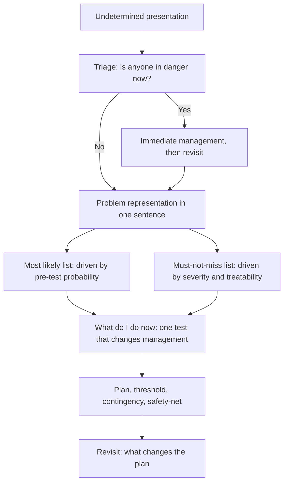

# Undifferentiated and New Presentations

Step 3 "tests your ability to apply medical knowledge and understanding of biomedical and clinical science for unsupervised practice". The word that makes this topic distinct is *unsupervised*. In Step 2 CK a stem is a question with a right answer sitting behind it: this presentation, most likely diagnosis, next investigation. In Step 3 the same stem arrives without a supervisor, a confirmed diagnosis and, often, without the result of the test you would have ordered in an earlier step. What you are shown is a patient in trouble, and the question is what you do next.

For the 2027 eligibility period the Bulletin describes Step 3 as a two-day exam: Day 1, Foundations of Independent Practice, at approximately 232 questions across twelve 30-minute blocks in a session of roughly seven hours, and Day 2, Advanced Clinical Medicine, at approximately 180 questions across nine 30-minute blocks plus 13 to 14 computer-based case simulations, each case allotted a maximum of 10 or 20 minutes of real time. The case simulations affect both the score and the pass or fail outcome, in no greater proportion than the time allotted to them. That structure matters here. A case simulation is exactly the format in which the diagnosis is withheld, the clock is running and the examiner is watching the sequence of your decisions rather than your recall of a fact.

So the examinable skill in this topic is not differential diagnosis as a list. It is the ability to hold an undifferentiated problem, decide what is dangerous, decide what is likely, decide what to do while both remain unsettled, and write a plan that survives the patient changing. Every Step 3 item built on an undifferentiated presentation is testing four things in sequence, and the marks fall on the sequence.

### 🟢 Lite — Quick Review (1h–1d)

**T-P-M-W, in that order, for every undifferentiated patient.**

| Step | The question | The output |
|---|---|---|
| **T** — Triage | Is this patient in danger in the next few minutes? | Immediate actions, or reassurance that there are none |
| **P** — Problem representation | In one sentence, who is this and what is wrong? | A single-line framing that excludes some diagnoses |
| **M** — Must-not-miss | Which diagnoses cannot be allowed to be missed here? | A short, separate, severity-driven list |
| **W** — What now | What will I do today, and what will I do if they worsen? | Actions, contingencies, safety-net |

**Two lists, never one.** The *most likely* list is driven by pre-test probability: age, sex, risk factors, tempo, exposure. The *must-not-miss* list is driven by severity and treatability: aortic dissection, pulmonary embolism, bowel ischaemia, meningitis, ectopic pregnancy, cauda equina. They rarely point at the same diagnosis. The most likely is what you will probably write about; the must-not-miss is what you will be judged for having covered.

**A new presentation gets three extra questions.** Has this been labelled before, and was that label right? What has actually changed? What else does this look like when the previous explanation no longer fits?

**Four statements that earn marks in almost every undifferentiated item.**

- The patient is safe to be managed as an outpatient or not, and why.
- Which diagnosis would change management if missed, and whether it has been excluded.
- The next test, and what result would change management.
- The contingency: what would make you bring this patient back.

**Traps that catch candidates.**

- Anchoring on the first plausible diagnosis and treating the rest as confirmation.
- Listing twelve differentials and ranking none of them.
- Ordering every available test instead of choosing one that changes management.
- Waiting for a diagnosis before treating something time-critical.
- Never saying what you would do if the patient deteriorated.
- Treating "undifferentiated" as "unanswerable" and hedging the whole answer.

**Memory anchors.**

- **T-P-M-W** — triage, problem representation, must-not-miss, what now.
- **Two lists** — likely is not the same as dangerous.
- **Never treat before diagnosing** is wrong; **never treat before you have a safe plan** is also wrong. Say which is which.

**Where this tier takes you next.**

- [the opening minutes of an encounter](/notes/usmle/step-3/s3-001/)
- [Step 2 CK presentations](/notes/usmle/step-2-ck/s2-002/)
- [the USMLE exam hub](/exams/usmle/)

### 🟡 Standard — Full Coverage (1–2d)

#### What makes an item undifferentiated

The stem gives you a symptom, a sign or a vague complaint, and the answer options are actions rather than diagnoses. Four things are usually missing, and each missing thing is the source of the mark.

**The diagnosis is missing.** You must generate it, which means you cannot let the option list narrow your thinking for you. If you read the options first, you will recognise them and stop thinking — and the option list in a good undifferentiated item contains a distractor for the commonest anchoring error.

**The severity is missing.** "Chest pain" in a 68-year-old and "chest pain" in a 25-year-old are different problems, and the stem usually gives you the age and the risk factors precisely so you can rank them.

**The tempo is missing or buried.** Sudden, gradual, episodic, progressive and "steadily worsening over six weeks" are the most informative words in any undifferentiated stem, and they do most of the work that a diagnosis would otherwise do.

**The result is missing.** Whatever test you would have ordered in Step 2 CK comes back later, and the case moves on. So the question cannot be "what is the diagnosis" — it has to be "what do you do with what you have".

#### Step 2 CK asks a different question from Step 3

Step 2 CK presents problems to test clinical knowledge. The most common item shape there is: given this presentation, which diagnosis, and which investigation. Step 3 takes the same presentations and asks what happens next — with the diagnosis unresolved, the result pending and no senior to call. Concretely, in Step 3 you are assessed on the *management plan and its contingencies*, not on the label. A candidate who says "I would treat this as a possible pulmonary embolism" has answered a Step 2 question and left a Step 3 mark on the table, because the examiner wants the actions, the thresholds and the safety-net.

#### Building the problem representation

One sentence, built from the stem, that captures who this is and what is wrong. It should exclude diagnoses as well as include them, which is what makes it useful: a representation that could describe any patient with abdominal pain has not done its job.

The components, in the order you assemble them: age and sex; the presenting problem in one phrase; site and radiation; tempo and severity; relevant risk factors and comorbidity; what has already been done or tried; and the patient's own account of what worries them.

**Worked representation.** "A 68-year-old man, three days of central chest pain radiating to the left arm, worse on exertion, with hypertension and hyperlipidaemia, no previous cardiac history, pain partly relieved by rest, and a non-diagnostic initial ECG." That sentence has already excluded aortic dissection (no tearing, no pulse asymmetry mentioned, but not excluded), excluded pulmonary embolism (no pleuritic pain, no risk features) and raised myocardial ischaemia to the top of the list. The representation is not a summary of the stem. It is a filter.

#### Three passes over the differential

**Pass one: the common.** What does the pre-test probability say? Use age, sex, risk factors, tempo, exposure and prevalence. This pass produces one or two diagnoses, not a list.

**Pass two: the must-not-miss.** What would be catastrophic to miss, is treatable, and could plausibly present this way? This pass produces a short list that is usually different from pass one, and it is the list that drives your investigations and your thresholds.

**Pass three: the uncommon.** Only enter this pass when the common causes do not fit and the stem contains a clue that demands it. A young patient with a rash and arthralgia after a camping trip is not the same as a young patient with a rash. If the stem offers nothing that discriminates, the uncommon diagnoses stay out — including in an exam item where one of the options is a rare disease, because the option list is not evidence.

**Structure matters more than length.** A differential organised by mechanism survives contact with new information; a list of disease names does not. "Ischaemic, inflammatory, obstructive, perforation, pancreatitis" is a framework. "MI, GERD, PUD, gastritis, pancreatitis, cholecystitis" is a list. When the investigation comes back showing a raised amylase, a mechanism framework tells you immediately that pancreatitis is now the leading branch and that you should check for a gallstone cause; a list of names tells you only that you were right to include one of them.

#### Managing while the picture is incomplete

Some treatments are safe enough to give before the diagnosis is certain, and some are not. The judgement is about cost, not about confidence.

| Situation | Do now | Do not wait for |
|---|---|---|
| Chest pain with a non-diagnostic ECG | Serial ECG and troponin, antiplatelet therapy where the risk justifies it, observe | A definitive cardiac diagnosis |
| Suspected sepsis | Cultures and lactate, broad-spectrum antibiotics, fluids | Source localisation |
| Acute abdomen | Resuscitate, give analgesia, investigate | A settled diagnosis |
| Diabetic ketoacidosis | Fluids and insulin | A completed anion gap calculation |
| Stroke pathway | Imaging and time-critical treatment in parallel | Finishing one before starting the other |
| Suspected meningitis | Immediate antibiotics, do not wait for imaging or lumbar puncture | A positive lumbar puncture |

The counter-mistake is as expensive: giving a treatment whose harm is high, whose dose depends on a diagnosis you do not have, or which obscures the picture you are trying to read. Antibiotics in a patient who turns out to have a non-bacterial illness, anticoagulation before you know whether there is a bleed, steroids before you have excluded infection in a patient who might be in adrenal crisis — each of these is a decision that needs a reason, and the reason is not "I was unsure".

#### Worked example 1 — chest pain with a non-diagnostic ECG

**The stem.** A 68-year-old man with three days of central chest pain, partly relieved by rest, hypertension and hyperlipidaemia. The initial ECG shows sinus rhythm with non-specific ST-T changes. Troponin has been sent. He is comfortable, in sinus rhythm, and blood pressure is stable.

**Triage.** Nothing immediately life-threatening: he is stable, perfusing, without shock or hypoxia. So no resuscitation, and the clock is not the emergency.

**Problem representation.** "68-year-old man with new exertional central chest pain over three days, with hypertension and hyperlipidaemia, ischaemic-sounding but non-diagnostic ECG, troponin pending."

**Most likely.** Stable angina or unstable angina (NSTE-ACS is the working term for the management). **Must-not-miss:** aortic dissection, pulmonary embolism, myocardial infarction, and cardiac tamponade from an aortic aneurysm rupture — less likely but the ones that kill.

**What now.** Serial ECGs and serial troponins rather than a single set, because a non-diagnostic ECG does not exclude infarction. Observations, pain control, and antiplatelet therapy where the risk of bleeding is not prohibitive. Troponin result review and a formal risk assessment. The candidate who orders a CT angiogram for dissection, a V/Q or CTPA for embolism and a formal echocardiogram all at once has answered "what could it be" rather than "what do I do now", and has spent an hour shearing down the chest-pain pathway.

**The contingency.** Recurrent pain, any dynamic ECG change, a rising troponin, or hypotension triggers an immediate change of plan — invasive investigation, and a cardiology discussion in the same hour, not the next morning. That sentence is worth more than any individual test.

#### Worked example 2 — fatigue and weight loss, no diagnosis offered

**The stem.** A 34-year-old woman has had six weeks of fatigue, has lost 7 kg without trying, has night sweats twice a week and has a tender cervical lymph node. She has not travelled and has no new pets.

**Problem representation.** "34-year-old woman, six weeks of constitutional symptoms with weight loss, night sweats and cervical lymphadenopathy, no obvious infectious focus."

**Most likely.** The B-symptoms plus lymphadenopathy put lymphoma high on the list; the same pattern with a different age, a chronic cough or a bone lesion would move tuberculosis up the list. **Must-not-miss:** lymphoma, tuberculosis, HIV with an opportunistic infection, and a haematological malignancy generally.

**What now.** A full history with exposure, sexual health, medication, weight trajectory and full systems; a thorough examination including of every lymph node group, the abdomen for hepatosplenomegaly, and the skin; and bloods with a full blood count, film, ESR or CRP, liver and renal function, LDH, and an HIV test offered rather than assumed. The specific next investigation depends on the examination, which is the point: the node, if it is large enough, is biopsied, and that decision comes from the examination finding rather than from the symptom list.

**What to avoid.** Ordering a chest CT and a tumour marker panel before the history and examination, because both are downstream decisions that the examination should have determined. Ordering a "full work-up" in a single undifferentiated request, which delays every individual result and guarantees a second round of imaging.

#### Worked example 3 — a genuinely new presentation

**The stem.** A 55-year-old man has never had palpitations. This morning he had an episode of pounding heartbeat lasting about ten minutes, which came on while standing in a queue, and he fainted briefly at the end of it. He has no cardiac history but drinks heavily and smokes.

**The three extra questions.** Has this been labelled before? No — so there is no prior label to lean on. What has actually changed? The new element is syncope with palpitations, not the palpitations. What else does this look like? The same picture fits paroxysmal tachycardia, an arrhythmia from structural heart disease, a drink-related atrial fibrillation, and a seizure with postictal collapse.

**Triage.** He is currently asymptomatic and stable, so this is a planned investigation problem, not a resuscitation problem. But syncope with palpitations carries a risk of sudden death, and the safe plan is one that treats that risk as real until it is excluded.

**What now.** ECG now, which is the single most valuable test because it catches the arrhythmia if it is still running, plus bloods including electrolytes and a thyroid function test, and a deliberate decision about inpatient monitoring versus ambulatory investigation. The honest answer in an undifferentiated case often includes "this patient needs a rhythm trace during symptoms", and the examiner wants to hear that you know that a resting ECG is only informative if it catches the rhythm.

#### When is the differential complete enough to discharge?

Never on the diagnosis alone. A patient can be discharged with an unresolved differential if three things are true: the most likely diagnosis has been excluded or is safely treatable at home; the must-not-miss list has been actively addressed rather than merely written down; and the patient has a safety-net that is specific enough to act on.

The safety-net has three parts: what to watch for, what to do about it, and when to return. "If it gets worse, come back" is not a safety-net. "If the pain returns, becomes more severe, or you develop breathlessness, sweating or vomiting, call the number on this card or attend the emergency department immediately" is. In the examination, a candidate who states a specific return trigger and a specific action is marking the difference between a plan and a hope.

### 🔴 Deep — Mastery (3–5d)

#### The cognitive traps, and the counter-move for each

| Trap | What it looks like | The counter-move |
|---|---|---|
| Premature closure | The first diagnosis that fits is adopted and the rest are dismissed | Write the must-not-miss list before you write the likely list |
| Anchoring | Every new piece of information is interpreted to support the first idea | State what would change your mind, in advance |
| Diagnostic momentum | A previous label travels with the patient and is treated as fact | Re-derive the problem representation from this attendance only |
| Availability bias | A recent or memorable case dominates the differential | Ask what else the top diagnosis cannot explain |
| Framing | The label in the referral or the nurse's handover sets the frame | Generate two differentials from the raw facts before reading anyone else's label |
| The normal-finding trap | One normal test is treated as excluding a serious diagnosis | Name the sensitivity of the test you are relying on |

The counter-move that generalises is **the re-derivation rule**: the problem representation is built from the patient's own account and your own examination, not from the referral text, and it is rebuilt at every change in the picture. A patient whose pain was "cardiac" on the previous attendance is not a cardiac patient until this attendance says so.

#### Why the case simulation format changes your behaviour

A computer-based case simulation is interactive: the information you receive next depends on what you do, and the clock runs in real time against the whole case. Two consequences follow, and both are worth practising deliberately.

**First, information-gathering actions are often worth more than tests.** In a simulation, choosing "ask about the family history" or "examine the pulses" can unlock the discriminating detail, while choosing "CT chest" consumes the clock and returns a report you may not need. The candidate who reflexively selects the most dramatic test first often runs out of time before the case reveals itself.

**Second, the action you choose gates what you see.** If you skip the ECG and the patient then deteriorates with an arrhythmia, the case turns. If you give the wrong antihypertensive, the case turns. Sequencing is not a stylistic preference; it is the mechanism of the simulation.

**Practical drill.** Run a timed case with three rules: no test before a focused history and examination; every action gets a reason stated in one sentence; and the last two minutes are reserved for the plan and the contingency, never for another investigation.

#### The handover of an undifferentiated patient

An undifferentiated patient handed over badly is how patients are harmed, and the exam marks the handover explicitly. A safe handover has six parts, in this order: what the problem is; what has been done and what the result was; the current observations and the trend; what you are worried about, named specifically; what you have done about that worry; and what you want the receiving clinician to do.

The part most often missing is the fifth. "I am worried about dissection" without "I have started the beta-blocker and the CT is booked for the morning" transfers anxiety rather than management. The part most often missing second is the trend: a patient whose blood pressure has drifted from 130 to 95 over three hours with a flat heart rate is a different patient from one whose blood pressure is 95 and stable.

#### Safety-netting, properly

Safety-netting is not a courtesy line at the end. It is a specific set of instructions that converts an unresolved differential into a managed risk.

**Name the specific symptoms** that should trigger a return, drawn from the must-not-miss list rather than from a generic list. If the must-not-miss is pulmonary embolism, the return triggers include sudden breathlessness, pleuritic pain, syncope and unilateral calf swelling. If it is cauda equina, they include saddle anaesthesia, new bladder or bowel symptoms, and new leg weakness. A generic "if you feel unwell" is a symptom-free sentence.

**Name the action.** Who to call, what number, and where to go if it is out of hours. If the patient has no phone or lives alone, the plan needs a different route.

**Name the timing** of any planned review and who is responsible for it, because a planned review nobody owns is not a plan.

#### Common mistakes

- Writing a differential list without ranking it, and presenting it as if the ranking were implicit.
- Treating the must-not-miss list as a checklist to be ticked rather than a list that drives actions.
- Ordering a battery of tests when one would change management.
- Treating a stable patient as an emergency, which wastes the time the unstable ones need.
- Treating an unstable patient as a diagnostic problem, which is the more expensive error.
- Omitting the contingency: no statement of what would change the plan or what would trigger escalation.
- Discharging with "no cause found" and no specific safety-net.
- Writing "prescribe analgesia and review in clinic" as a plan, which is what a candidate writes when they have run out of thinking.

> ⚠️ **Examiner Trap.** The distractor in an undifferentiated Step 3 item is almost never a clinically wrong action. It is a correct action placed one step too late, or a defensible action that ignores the cost. Reading the options in order and asking "is this right?" picks it. Asking "is this next, and does it change what happens?" does not.

#### Memory anchors

- **T-P-M-W** — triage, problem representation, must-not-miss, what now. Four steps, four outputs, in that order.
- **Likely is not dangerous.** Two lists, always.
- **Manage what is safe, investigate what is not.** The cost of delay decides.
- **Re-derive.** The problem representation comes from this attendance, from the patient's own words, not from the referral label.
- **State the trigger.** A safety-net without a named symptom and a named action is not a safety-net.

#### ⚡ Quick Exam Checklist

- Triage answered before any differential is written
- Problem representation is one sentence and excludes as well as includes
- Likely list and must-not-miss list produced separately, with severity reasoning visible
- Differential organised by mechanism, not by a list of disease names
- Management started for anything time-critical, without waiting for a label
- Every investigation justified by a decision it would change
- Plan names what happens next, by when, and who does it
- Contingency stated: what deteriorates, what changes, and who is called
- Safety-net names specific symptoms, a specific action and a specific route
- Discharge decision justified against the must-not-miss list, not against the diagnosis
- Escalation triggered by physiology and trajectory, not by personal unease
- Handover includes what was done about the specific worry, not only the worry
- Re-derivation of the problem representation from this attendance
- Pre-test probability stated where the item gives the risk factors

**Where this tier takes you next.**

- [management and initial stabilisation](/notes/usmle/step-3/s3-001/)
- [inpatient and discharge management](/notes/usmle/step-3/)
- [the USMLE exam hub](/exams/usmle/)

## Internal links

- [USMLE exam hub](/exams/usmle/) — the three steps and what each one assesses.
- [Management and Initial Stabilisation](/notes/usmle/step-3/s3-001/) — the ordering this topic extends to patients without a diagnosis.
- [Medicine by Presentation](/notes/usmle/step-2-ck/s2-002/) — the Step 2 CK counterpart, where the question is which diagnosis rather than what to do.
- [Emergency and Critical Care](/notes/usmle/step-3/) — where the triage step lives in time-critical presentations.

What Step 3 assesses, and the two-day structure with its 30-minute blocks and computer-based case simulations for the 2027 eligibility period, are quoted from the FSMB/NBME USMLE site (https://www.usmle.org/, retrieved 24 October 2026). Scoring scale, pass thresholds and fees are not stated here because they were not verifiable at build time, so check NBME directly before registering. The topic weight is StudyRoadmap's own prioritisation, not an NBME blueprint.

---

## Continue your study

- **[View this topic in your USMLE (United States Medical Licensing Examination) roadmap](/roadmap/?exam=usmle&duration=1mo)** — see where this topic sits in your personalised plan
- **[Build a quick revision plan](/roadmap/?exam=usmle&duration=1d)** — 1-day sprint covering the highest-weight topics
- **[USMLE (United States Medical Licensing Examination) exam overview](/exams/usmle/)** — pattern, eligibility, and syllabus
- **[All Step 3 (Unsupervised Practice) notes](/notes/usmle/step-3/)** — browse sibling topics in this subject
