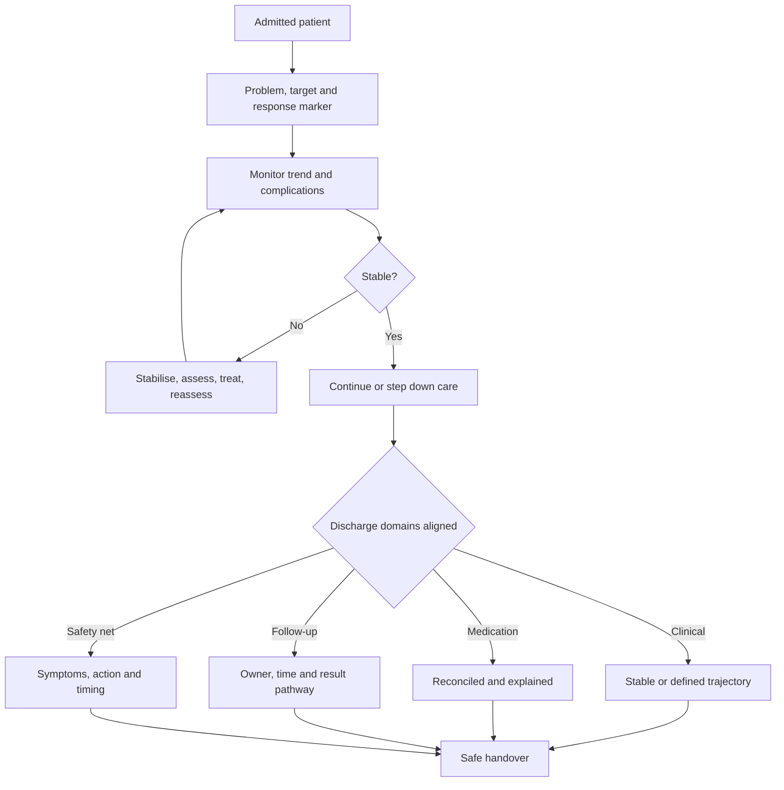

# Inpatient and Discharge Management

Step 3 asks what happens after the diagnosis is known. An inpatient item gives a patient who is admitted, started on treatment and then changes. The question is whether the candidate notices deterioration, reacts to it, and adjusts the plan. A discharge item gives a patient who says the acute problem is better. The question is whether the candidate can define stability, reconcile the medication list, organise follow-up and prevent a crisis after the patient goes home.

The two halves are joined by one idea: treatment does not finish when the prescription is written. It finishes when the patient's physiology is stable outside the hospital, the patient understands the plan, the follow-up system is reliable, and everyone who needs the information has it.

### 🟢 Lite — Quick Review (1h–1d)

**The inpatient ward round, in order.**

1. **Reassess the patient.** Look at the patient, not only the chart. Check the trend in observations, oxygenation, perfusion, intake and output, pain, nausea, mobility and mental state.
2. **Restate the problem.** What is being treated, and what response should show that the treatment is working?
3. **Review the data.** New examination findings, laboratory results, imaging, microbiology, procedure reports and nursing observations.
4. **Review the medicines.** Continue, stop, adjust or time-limit each drug. Check interactions, renal dosing, allergies and adverse effects.
5. **Look for complications.** Bleeding, infection, thromboembolism, delirium, pressure injury, falls, nutrition and mobility.
6. **Define the next step.** Continue, investigate, treat, consult, transfer the level of care or prepare for discharge.
7. **Check discharge readiness.** Start the plan on the day of admission rather than on the day of departure.

**Response to treatment.** A treatment is working when the expected physiological marker moves in the intended direction within the expected time. Write the target down. Examples include oxygenation, respiratory rate and work of breathing in pneumonia; urine output, weight and creatinine in acute kidney injury; temperature, heart rate and blood pressure in sepsis; pain score and function after surgery; and haemoglobin trend in bleeding.

A patient who looks better but has worsening kidney function has not recovered. A patient whose fever settles but develops a new focal neurological deficit has not recovered. Trends across several markers are stronger evidence than one normal number.

**Deterioration: a structured response.**

| Step | Action |
|---|---|
| Recognise | Compare current observations with baseline, previous values and expected trajectory |
| Stabilise | Address airway, breathing and circulation; obtain senior help for a sick patient |
| Assess | Focused examination, bedside glucose, ECG, imaging, laboratory tests and cultures as indicated |
| Treat the cause | Antibiotics, source control, airway support, fluid or blood products, medication reversal and surgery |
| Reassess | Repeat observations and the response marker; document a clear plan |

Early warning scores support recognition but do not replace clinical judgement. A patient can deteriorate with a score that has not crossed a threshold, and one abnormal value can be harmless in isolation. Use the score to structure attention, then look at the patient.

**Escalation.** Escalate early and state the problem clearly. "This patient is on the second day of antibiotics for pneumonia and now has a new oxygen requirement of four litres with confusion; I think this is sepsis and want the critical care team and the respiratory team to assess now" is a useful referral. It gives the location, the trend, the concern and the requested action. A vague call for "someone to look" loses time.

**Fluid and electrolyte management.** Maintenance fluid needs depend on age, weight, oral intake and ongoing losses. Replace clinically evident deficits with isotonic fluid and reassess perfusion, lung signs and urine output. Avoid automatic fluid loading in a patient with heart failure or kidney disease. Check sodium, potassium, magnesium and phosphate when losses or replacement therapy make abnormalities likely. Fluid overload is a real cause of respiratory deterioration.

**Medication reconciliation.** Build one accurate list: what the patient was taking before admission, what is needed in hospital, what can stop, and what must continue after discharge. Reconcile sources rather than trusting a single document. Watch for duplicate therapy, a changed dose, renal adjustment, anticoagulant and antiplatelet interactions, insulin, opioids, sedatives and medicines started for an indication that has resolved.

**Discharge criteria.** A patient is ready for discharge when several domains align.

| Domain | Evidence of readiness |
|---|---|
| Clinical | Acute problem is controlled or has a defined stable trajectory |
| Physiology | Observations and relevant laboratory values are within an agreed acceptable range |
| Function | The patient can perform the activities needed for home life, with assistance if needed |
| Cognition and capacity | The patient can understand and act on the plan, or a surrogate can support it |
| Medication | Prescriptions are reconciled, accessible and explained |
| Support | Help at home, equipment, transport or social support is in place |
| Follow-up | A named service, timeframe and contact plan exist |
| Safety net | Specific warning symptoms, actions and access routes are documented |

**The discharge summary.** It should contain the presenting problem, key investigations, diagnosis and course, procedures, discharge medicines with doses and duration, pending results and their owners, follow-up arrangements, return triggers and contact details. “Discharged stable” is not a summary. The next clinician should be able to reconstruct the illness and the outstanding plan from it.

**Pending results.** Every pending investigation needs an owner, a timeframe and a route for acting on an abnormal result. A patient should not have to call the ward because a scan was reported after discharge. The hospital system owns the result until responsibility for follow-up is clearly assigned.

**Safety-netting.** Name the symptoms, the action and the timing. “If the fever returns, or your breathing becomes difficult, contact the urgent care service or attend the emergency department. If you develop swelling in the leg, contact the team on the number provided.” This is specific enough to act on. “Come back if you get worse” leaves the patient to define worse.

**Teach-back.** Ask the patient to explain the plan in their own words: how to take each medicine, what to do about a missed dose, which symptoms require action and when the next review occurs. Teach-back tests the clarity of the teaching, not the intelligence of the patient. If the explanation is incomplete, teach it again in another way.

**Readmission is a system signal.** Readmission after discharge points to problems that can occur before, during or after the handover: incomplete assessment, poor medication reconciliation, no follow-up, weak communication, limited access or a plan the patient could not execute. Reviewing the event as a system prevents the same failure in the next patient.

**Memorise for the Lite tier.**

- Reassess the patient and the trend on every round.
- Write the expected response before judging treatment.
- Deterioration: recognise, stabilise, assess, treat, reassess.
- Escalate early with the trend, concern and requested action.
- Reconcile every medicine; record what stops and what continues.
- Discharge readiness is clinical, functional, cognitive, medication, support, follow-up and safety-net readiness.
- Every pending result needs an owner and a timeframe.
- Safety-netting names the symptom, action and timing.

### 🟡 Standard — Full Coverage (1–2d)

#### Worked example: the pneumonia patient who worsens on day two

**The stem.** A patient with community-acquired pneumonia is admitted with low oxygen requirement and receives antibiotics, fluids and analgesia. On the second day, the respiratory rate rises, oxygen needs increase and the patient is confused.

**Triage.** This patient has acute deterioration. Confusion with a rising oxygen requirement suggests hypoxaemia and sepsis physiology. Immediate actions include airway and breathing assessment, oxygen and ventilatory support as needed, intravenous access, blood cultures and lactate when sepsis is suspected, and prompt senior review. Antibiotic, antiviral or other targeted treatment is adjusted if a resistant pathogen or another cause is found.

**Reassess the diagnosis.** The initial organism is not guaranteed. Consider resistant or unexpected infection, aspiration, pulmonary oedema, atelectasis with mucus plugging, pulmonary embolism, progression of pneumonia and fluid overload. Look at the drug chart, culture results, imaging and trends. A patient with rising oxygen needs after several litres of fluid also needs a fluid balance review.

**Reconsider the plan.** The treatment has not produced the intended response. Escalate respiratory support, involve critical care for a deteriorating patient with sepsis, review antimicrobial choice after cultures and local resistance data, and address complications. Repeat assessment must be written with a timeframe and a named trigger for further escalation.

**The reasoning.** This is not "the pneumonia is severe". It is a patient who has changed, a threat to oxygenation and perfusion, and a treatment that has failed to meet its target.

#### Worked example: heart failure and the hidden fluid problem

**The stem.** A patient with heart failure is admitted with pulmonary oedema. After two days of diuresis, the oxygen requirement improves and weight falls. On the third day, the patient becomes hypoxic again with bilateral crackles and increasing oxygen needs.

**Triage.** Treat this as recurrent pulmonary congestion while assessing for another cause such as pneumonia, ischaemia, arrhythmia or pulmonary embolism. Review the current fluid balance, sodium, kidney function and heart rate. Give appropriate diuresis and respiratory support.

**Reassess the plan.** A patient with heart failure does not need a fixed amount of fluid. The target is adequate perfusion with the lowest volume that keeps the lungs clear. This means daily weights, strict intake and output, examination for jugular venous pressure, oedema and lung sounds, and renal function. Review sodium and potassium because diuresis and neurohormonal blockade affect them.

**Prevent readmission.** Discharge when the patient is euvolaemic on a stable oral regimen, understands daily weights and when to call, and has early follow-up with a heart failure team or clinician. A reduced admission weight and a clear action plan are more informative than a normal chest radiograph alone.

#### Worked example: a discharge that avoids a medication crisis

**The stem.** A patient with heart failure and chronic kidney disease is admitted with pneumonia. During admission, furosemide is increased and a new non-steroidal anti-inflammatory drug is prescribed for back pain. At discharge, the patient is clinically improved.

**The problems.** The NSAID retains sodium and water, blunts diuretic and kidney effects, and can worsen renal function. Increased diuresis can produce hypokalaemia and volume depletion. The discharge medication list may contain three different versions of the diuretic regimen. A blood test shows that creatinine rose during admission.

**The safe discharge.** Stop the NSAID or give a clear alternative and duration. Reconcile the home diuretic, inpatient increase and intended discharge dose into one instruction. Repeat kidney function and electrolytes after the change, and adjust the regimen if needed. State the follow-up test and who will review it. Give written instructions for daily weight, sodium and potassium-containing products, and specific symptoms that require contact. Arrange follow-up linked to the renal result and clinical review.

**The reasoning.** Clinical improvement does not make an unreviewed medication change safe. The discharge plan has to account for the interaction between treatment and comorbidity.

#### Worked example: cellulitis discharge after observation

**The stem.** A patient with moderate cellulitis has received intravenous antibiotics, the erythema has reduced and there is no fever. Discharge is planned with oral antibiotics.

**What must be completed.** The infection should be improving, systemic symptoms should be absent and the patient should be able to take oral medication and return for review. The prescription needs the correct drug, dose, duration, allergy information and instructions. The wound plan needs dressing, elevation and a method for reporting increasing redness, pain or drainage.

**Why the patient can deteriorate after discharge.** Infection can extend, the oral antibiotic can fail because the organism is resistant or the absorption is poor, and the initial reduction in redness can reflect the immune response rather than control of the organism. Some patients need a repeat examination and intravenous treatment if improvement stalls. The discharge plan must identify who reviews the wound and when.

**Safety-net.** Give a written list of specific changes: spreading redness, increasing pain, fever, drainage, difficulty taking the medicine or a new systemic symptom. State the action and route. A wound photograph can help track change but does not replace review.

#### Worked example: safe discharge after pulmonary embolism

**The stem.** A patient with an acute pulmonary embolism is treated with anticoagulation and is haemodynamically stable with improving oxygenation. There is no bleeding and kidney function supports the intended regimen.

**What the discharge plan needs.** The anticoagulant is named with dose, duration and purpose. The plan explains what happens if a dose is missed and why the patient should not stop anticoagulation without advice. Bleeding warning signs are specific, including black stools, blood in urine, severe headache, unusual bruising and persistent bleeding. A warning about when to seek emergency care is included.

**What can go wrong.** Interactions with NSAIDs, antiplatelets and over-the-counter products are reviewed. Renal function, anaemia and other bleeding risks are checked. Follow-up is arranged to assess anticoagulation, adherence and complications. The emergency plan for recurrent symptoms such as chest pain, breathlessness, syncope or haemoptysis is explicit. The date for review of the intended duration is recorded rather than left as an indefinite prescription.

**The reasoning.** Discharge safety includes the treatment's burdens and risks, not just the reason it was started.

### 🔴 Deep — Mastery (3–5d)

#### Monitoring that detects change

A ward round becomes a safety tool when monitoring is tied to a hypothesis. For every active problem, record the marker, the expected direction, the expected timeframe and the threshold for action.

| Problem | Marker to follow | Why it matters |
|---|---|---|
| Pneumonia | Oxygen requirement, respiratory rate, work of breathing, temperature | Detects respiratory failure and treatment failure |
| Sepsis | Perfusion, mental state, urine output, lactate trend | Detects ongoing organ dysfunction |
| Acute kidney injury | Urine output, creatinine, fluid balance and electrolytes | Guides fluids, dialysis and medication dosing |
| Heart failure | Weight, symptoms, examination, renal function, sodium and potassium | Detects congestion and over-diuresis |
| GI bleeding | Haemoglobin trend, vital signs, abdomen, stool and drain findings | Detects recurrent or ongoing bleeding |
| Postoperative state | Pain, mobility, respiratory status, wound, urine output | Detects atelectasis, infection, bleeding and retention |
| Delirium risk | Attention, orientation, sleep, medication changes, sensory needs | Detects acute brain dysfunction |

Observations are useful as trends. A single temperature or heart rate has limited meaning; the direction across hours carries more information. The same applies to oxygen requirement and urine output.

#### Discharge as a process, not a moment

**At admission:** identify the expected length of stay, the likely discharge destination, the patient's baseline function, medication access, home support and barriers to follow-up. Ask what the patient will need to do after discharge and who will help. This prevents the team from designing a discharge plan around an assumption about the home.

**During admission:** update the plan as the clinical course changes. A new diagnosis, a renal impairment, a swallowing difficulty or a anticoagulant changes the discharge medication and destination. Begin teaching and arrange equipment and transport early.

**Before discharge:** confirm the clinical endpoint, repeat the tests that affect safety, complete medication reconciliation, involve the patient and caregiver, book follow-up, create the pending-results process, and document specific return triggers.

**At the handover:** give the receiving team or patient a summary that includes what was treated, the current state, the medication plan, pending actions, follow-up and warning signs. Verify that the patient can describe the plan in their own words.

**After discharge:** close the loop. A referral accepted at discharge is not the same as a completed appointment. Systems that send summaries, track referrals and contact patients who do not attend reduce the gap between the written plan and the completed plan.

#### Medication reconciliation, in depth

Reconciliation begins with the patient's actual use, not the clinic list. Ask about prescribed drugs, over-the-counter products, vitamins, supplements, allergies and recent medication changes. In hospital, compare the admission list, the medication administration record, pharmacy records and the discharge prescription.

Reconciliation catches several errors: a medication omitted after a temporary indication resolves; duplication between two agents; a dose carried forward despite renal impairment; an interacting combination; an inability to swallow a tablet; an injectable drug that can move to an oral form; and a medicine the patient never takes despite appearing on the list.

High-risk groups include patients with many medicines, renal or hepatic impairment, anticoagulant use, insulin, recent hospital transfers and limited health literacy. The clinical pharmacist, nurse and prescriber each see different errors, so the reconciliation is a team task.

#### The high-risk discharge

Readmission risk is not perfectly predictable, but a structured judgement helps. Consider recent admission, active heart failure or chronic lung disease, diabetes with complications, frailty, cognitive impairment, limited support, unstable housing, substance use, anticoagulation, renal dysfunction, medication complexity, pending investigations and a procedure with a recovery pathway.

A high-risk discharge needs more than a longer follow-up appointment. It needs a reconciled plan, a named owner, a reliable route for contacting the team, transport or home support where needed, and active outreach when the patient cannot attend.

#### Common mistakes

**Attributing deterioration to expected postoperative change.** Pain, mild fever and reduced appetite occur after surgery, but the trajectory and physiological signs still require assessment.

**Discharging because the diagnosis has been treated.** The endpoint is clinical stability in the context of comorbidity and home function, not completion of a course.

**Copying the medication list forward.** Each drug needs an ongoing indication, correct dose and a review date.

**Leaving pending tests with the inpatient team.** The result needs an owner and a patient-facing process for follow-up.

**Writing a vague safety-net.** Name symptoms, action and timing.

**Using discharge as the end of responsibility.** A patient who cannot obtain medication, cannot attend follow-up or cannot understand the plan remains at risk.

**Measuring patient understanding by asking whether they have questions.** People often say no to be polite. Teach-back tests the explanation.

#### Exam traps

A patient with improving pneumonia still has a rising creatinine and fluid overload. The answer is to adjust fluids and medicines and reassess, not to declare success because the infection improved.

A patient on warfarin has a lower international normalised ratio after the medication list is reconciled with a new antibiotic. The correct action is review the interaction and monitor coagulation.

A patient with recent pneumonia is discharged on an ACE inhibitor that was held for low blood pressure. The discharge plan must restart or not restart it with monitoring rather than leaving the decision unresolved.

A diabetic patient has an HbA1c above target at discharge. The plan includes medication reconciliation, a follow-up owner and self-management support; a one-line instruction to follow up is insufficient.

A patient with no reliable home support after a disabling stroke is medically stable. Discharge readiness now includes the assistance and equipment needed for safe transfer and daily function.

#### 🧠 Memory Anchors

- **Recognise, stabilise, assess, treat, reassess.**
- **A treatment has no target.**
- **Escalate with trend, concern and requested action.**
- **Reconcile: before, during, after.**
- **Discharge readiness has seven domains.**
- **Pending result: owner, timeframe, action route.**
- **Flashcard Q&A:**
  - *What is teach-back?* → Asking the patient to explain the plan in their own words.
  - *What should a discharge summary contain?* → Course, treatment, medicines, pending results, follow-up and return triggers.
  - *What makes a safety-net specific?* → Named symptom, action and timing.
  - *Why check weight in heart failure?* → It is a sensitive marker of fluid status and treatment response.
  - *What is a high-risk discharge?* → One with clinical, functional, medication or social vulnerability.

#### Internal links

- [USMLE exam hub](/exams/usmle/) — the three-step structure, sponsored by FSMB and NBME.
- [Management and Initial Stabilisation](/notes/usmle/step-3/s3-001/) — the first steps when an admitted patient deteriorates.
- [Undifferentiated and New Presentations](/notes/usmle/step-3/s3-002/) — the problem-representation discipline carried into ward rounds.
- [Patient Safety and Health Systems](/notes/usmle/step-3/s3-006/) — the system causes of readmission and failed handoffs.

The description of Step 3 quoted here is the wording used by the FSMB and NBME (https://www.usmle.org/ and https://www.nbme.org/). This page states no item counts, timing, the scoring scale, fees or the testing calendar, because those figures were not verifiable at build time. The topic weight is StudyRoadmap's own prioritisation, not an NBME blueprint.

---

## Continue your study

- **[View this topic in your USMLE (United States Medical Licensing Examination) roadmap](/roadmap/?exam=usmle&duration=1mo)** — see where this topic sits in your personalised plan
- **[Build a quick revision plan](/roadmap/?exam=usmle&duration=1d)** — 1-day sprint covering the highest-weight topics
- **[USMLE (United States Medical Licensing Examination) exam overview](/exams/usmle/)** — pattern, eligibility, and syllabus
- **[All Step 3 (Unsupervised Practice) notes](/notes/usmle/step-3/)** — browse sibling topics in this subject
